# Sintaxia · Aprende a programar jugando

Aplicacion web estilo **Duolingo pero para lenguajes de programacion**, desarrollada con
**Vue 3 + Vite + Vue Router** sobre **Supabase**: el contenido de los cursos, el acceso
(invitados, registro e inicio de sesion con **Supabase Auth**), los perfiles y el
historial de cada persona viven en una base PostgreSQL protegida con RLS.

Lecciones de cinco minutos, ejercicios interactivos con correccion inmediata, vidas, XP,
rachas, medallas y un camino de unidades que se va desbloqueando. Se puede entrar como
**invitado** (con un usuario propio) o **crear una cuenta con correo y contrasena**; un
invitado que crea su cuenta **conserva su historial**.

El curso implementado es el de **JavaScript**. Desde la etapa 3 los cursos, las
unidades, las lecciones y las actividades se leen de Supabase: hay una unidad
publicada (3 lecciones y 12 actividades de opcion multiple) y el resto de las
unidades queda como "proximamente" hasta que se cargue su contenido.

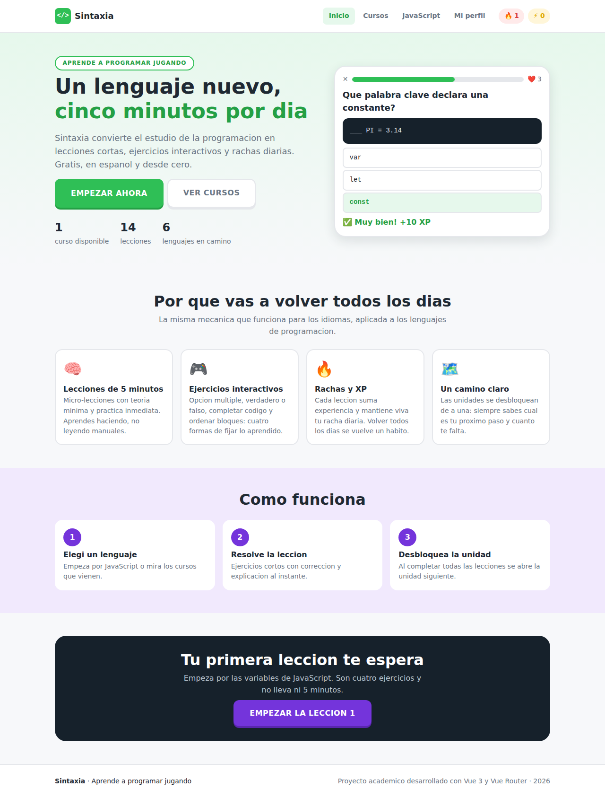

---

## Como ejecutarlo

### El contenido: Supabase

```bash
npm install
cp .env.example .env
#   Completa VITE_SUPABASE_URL y VITE_SUPABASE_PUBLISHABLE_KEY con los datos
#   del panel de Supabase (Project Settings -> API).
npm run dev        # http://localhost:5173
```

En el proyecto de Supabase hay que ejecutar, en este orden, los scripts de la
carpeta [`supabase/`](supabase/): `01-esquema.sql`, `02-datos-iniciales.sql`,
`03-politicas-rls.sql` y `04-funcion-comprobar.sql`. Los datos del proyecto y la
organizacion de las tablas estan en [`supabase/README.md`](supabase/README.md).

Sin cuenta, la app entra en **modo invitado** y guarda el progreso en el
navegador; el contenido igual sale de Supabase.

> En el `.env` del front solo va la **clave publicable**. Todo lo que empieza con
> `VITE_` queda dentro del paquete que se descarga el navegador: que sea una
> variable de entorno no lo convierte en secreto. La clave `service_role` no
> aparece nunca en la aplicacion.

### Probarlo en la maquina, con Supabase local

Las claves del proyecto real no se suben al repositorio, asi que las pruebas corren contra
un entorno local equivalente: **Supabase Auth real** (compilado desde su codigo fuente),
PostgreSQL con los mismos scripts de `supabase/` y una imitacion de la API de datos.

```bash
npm run auth:compilar     # una sola vez; hace falta Go
npm run supabase:local    # arma la base desde cero
npm run pruebas:entorno   # Auth + datos + correos de prueba + la app (queda corriendo)
npm run pruebas:etapa5    # en otra terminal (o etapa2, etapa3, etapa4)
```

Requiere **Node 18+**, **PostgreSQL 14+** y **Go** (solo para compilar Auth). Detalle en
[docs/13-registro-de-pruebas-etapa4.md](docs/13-registro-de-pruebas-etapa4.md) y
[docs/15-registro-de-pruebas-etapa5.md](docs/15-registro-de-pruebas-etapa5.md).

> El servidor Express con MySQL de la etapa 2 (carpeta `server/`) **ya no lo usa la
> aplicacion**: queda como referencia. El acceso paso a Supabase Auth.

| Script | Que hace |
|---|---|
| `npm run dev` | Solo el front |
| `npm run dev:api` | Solo la API, recargando al guardar |
| `npm run dev:todo` | Los dos a la vez |
| `npm run build` | Compila el front a `/dist` |
| `npm run db:migrar` · `db:sembrar` | Base de la etapa 2 (MySQL). Ya no se usa |
| `npm run auth:compilar` | Compila Supabase Auth para probar en local |
| `npm run pruebas:entorno` | Levanta Auth, API de datos, correos de prueba y la app |
| `npm run supabase:datos` | Regenera `supabase/02-datos-iniciales.sql` |
| `npm run supabase:local` | Prepara una base PostgreSQL local con los scripts de Supabase (pruebas) |
| `npm run supabase:puente` | Expone esa base local como la API de Supabase (pruebas) |
| `npm run pruebas:etapa2` | Recorrido de actividades y resultados |
| `npm run pruebas:etapa3` | Consultas a la base, permisos y manejo de errores |
| `npm run pruebas:etapa4` | Invitados, registro, sesion, conversion, recuperacion y RLS |
| `npm run pruebas:etapa5` | Intentos, respuestas, progreso, desconexion, peticiones repetidas y permisos |

---

## El logo

El logo vive en **`public/sintax/sintaxia.png`**. Con solo dejar el archivo ahi aparece en la cabecera,
el pie, la portada, la pantalla de ingreso, el 404 y como favicon: no hay que tocar codigo.

Mientras ese archivo no exista, la app dibuja un logo de respaldo en SVG, asi que nunca se ve
una imagen rota.

El componente `LogoSintaxia.vue` tiene dos variantes:

| Variante | Que muestra | Donde se usa |
|---|---|---|
| `icono` | Recorte cuadrado centrado en el buho | Cabecera, pie, 404 |
| `completo` | La imagen entera, con la palabra "Sintaxia" | Portada y pantalla de ingreso |

El recorte de la variante `icono` se ajusta con dos variables CSS, por si el buho queda
descentrado con otra version del logo:

```css
.logo--icono {
  --logo-zoom: 275%;    /* cuanto se agranda la imagen */
  --logo-foco-y: 30%;   /* que franja vertical queda a la vista */
}
```

Los valores salen de medir el PNG: el buho ocupa de `y=167` a `y=673` y la palabra arranca
justo debajo.

## Pensada tambien para el celular

La aplicacion tiene que funcionar igual en la web y en un telefono Android, asi que:

- **Bienvenida tipo app.** La primera vez que se abre, aparece una presentacion de cuatro
  pasos que se pasan deslizando y termina ofreciendo crear una cuenta, ingresar o seguir
  como invitado. En el escritorio se muestra encuadrada con el ancho de un celular.
- **Carruseles con `scroll-snap` del navegador**, no movidos con JavaScript: el gesto lo
  maneja el sistema, asi que se siente igual que en una app nativa (sigue el dedo y frena
  con inercia).
- **Se respetan la muesca y la barra de gestos** con `env(safe-area-inset-*)`.
- **Areas tocables comodas**: los puntos del carrusel miden 9 px pero se pueden tocar en un
  area de 31 px.
- Las flechas de los carruseles **solo aparecen si hay algo que desplazar**, y se esconden
  en pantallas chicas, donde se navega con el dedo.

## Sintax, la mascota

El buho del logo aparece en toda la aplicacion y **reacciona a lo que pasa**: celebra una
leccion perfecta, se enoja cuando se pierden las tres vidas, se confunde en el 404 y duerme
si hace rato que no practicas.

Las imagenes viven en **`public/sintax/`**, una por estado de animo:

| Archivo | Que muestra | Cuando aparece |
|---|---|---|
| `normal.webp` | Con la notebook, contento | Por defecto, y reemplaza a cualquiera que falte |
| `saludando.webp` | Alas arriba, ojos cerrados | Portada, ingreso y bienvenida |
| `confundido.webp` | Ala en el pico y un "?" | Pagina 404 y resultados flojos |
| `pensando.webp` | La lamparita de la idea | Pantallas vacias |
| `enojado.webp` | Notebook con la X roja | Cuando se pierden las tres vidas |
| `dormido.webp` | Acostado, con Zzz | Cuando todavia no empezaste |
| `celebrando.webp` | Anteojos de sol y destello | Leccion perfecta y racha de 3 dias o mas |
| `sorprendido.webp` | Ojos grandes, ala levantada | Al desbloquear algo nuevo |

Estan en **WebP**: pesan unas cinco veces menos que el PNG con la misma calidad (44 KB
contra 218 KB), que en el celular con datos moviles se nota. El componente igual acepta los
dos formatos.

Cada estado trae su propia animacion (flota, saluda, festeja, tiembla, duerme). Si falta un
archivo se prueba el PNG, despues `normal`, y por ultimo el logo: nunca queda una imagen
rota.

## Iconos

59 iconos SVG dibujados dentro del proyecto (`src/assets/iconos.js`), sin librerias ni CDN.
Heredan el color del texto, asi que cambian solos segun el contexto.

```vue
<Icono nombre="llama" :tamano="16" />
<Icono nombre="trofeo" :tamano="40" etiqueta="Curso completado" />
```

## Documentacion del trabajo practico

| Documento | Contenido |
|---|---|
| [1. Descripcion del proyecto](docs/01-descripcion-del-proyecto.md) | Objetivo, problema que resuelve, publico objetivo y funcionalidades |
| [2. Estructura y arquitectura](docs/02-estructura-y-arquitectura.md) | Vistas, rutas, carpetas, modelo de datos y comunicacion entre componentes |
| [3. Wireframes](docs/03-wireframes.md) | Bocetos de todas las pantallas principales, incluida la version movil |
| [4. Identidad visual](docs/04-identidad-visual.md) | Paleta, tipografias, botones, tarjetas, iconos y su justificacion |
| [5. Backend, autenticacion y base de datos](docs/05-backend-autenticacion-y-base-de-datos.md) | Modelo de datos, flujo OAuth, endpoints, medallas, ranking y seguridad |
| [6. Reglas de avance y finalizacion](docs/06-reglas-de-avance.md) | Completada contra aprobada, umbral, desbloqueo de lecciones y unidades |
| [7. Registro de pruebas](docs/07-registro-de-pruebas.md) | Los 11 casos probados, con problemas encontrados y correcciones |
| [8. Modelo de datos (DER)](docs/08-modelo-de-datos.md) | Tablas, tipos, claves y restricciones · diagrama en draw.io |
| [9. Demostracion](docs/09-demostracion.md) | Guion para mostrar el recorrido completo |
| [10. Supabase y modelo de datos](docs/10-supabase-y-modelo-de-datos.md) | Diccionario de datos, relaciones, politicas de RLS y funcion de comprobacion |
| [11. Registro de pruebas (etapa 3)](docs/11-registro-de-pruebas-etapa3.md) | Los 12 casos probados contra la base, con problemas y correcciones |
| [12. Acceso y sesiones (etapa 4)](docs/12-acceso-y-sesiones.md) | Invitados, registro, alias, permisos, configuracion de Supabase y decisiones |
| [13. Registro de pruebas (etapa 4)](docs/13-registro-de-pruebas-etapa4.md) | Los 35 casos, que es real y que simulado, problemas y lo que no se probo |
| [14. Intentos, respuestas y progreso (etapa 5)](docs/14-intentos-y-progreso.md) | Modelo, correccion en el servidor, duplicados, desconexion, perfil y migracion · [DER](docs/der/sintaxia-der-etapa5.png) |
| [15. Registro de pruebas (etapa 5)](docs/15-registro-de-pruebas-etapa5.md) | Los 22 casos, problemas encontrados y lo que no se probo |

---

## Pantallas

### Catalogo de cursos
Tarjetas reutilizables con buscador y filtros por estado.

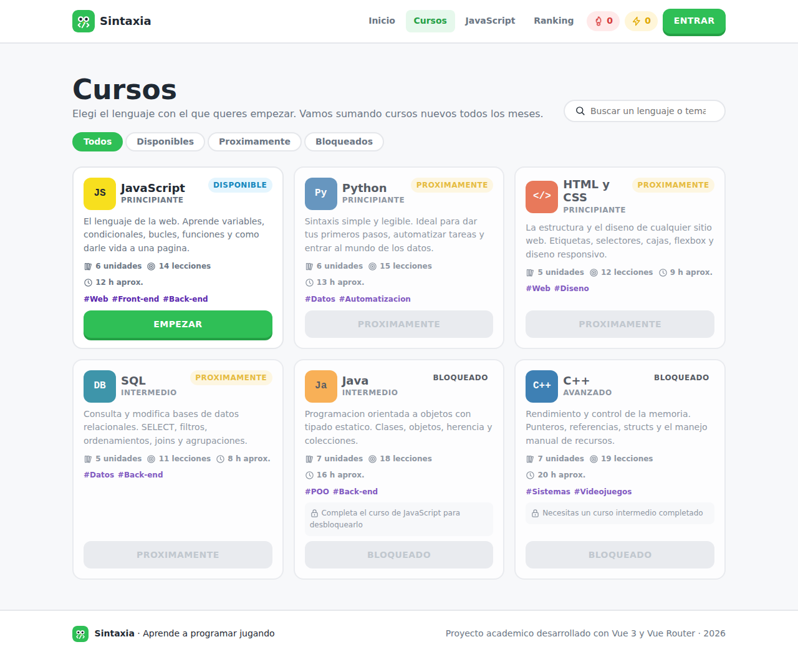

### Curso de JavaScript
El camino de unidades, cada una con su estado y su progreso.

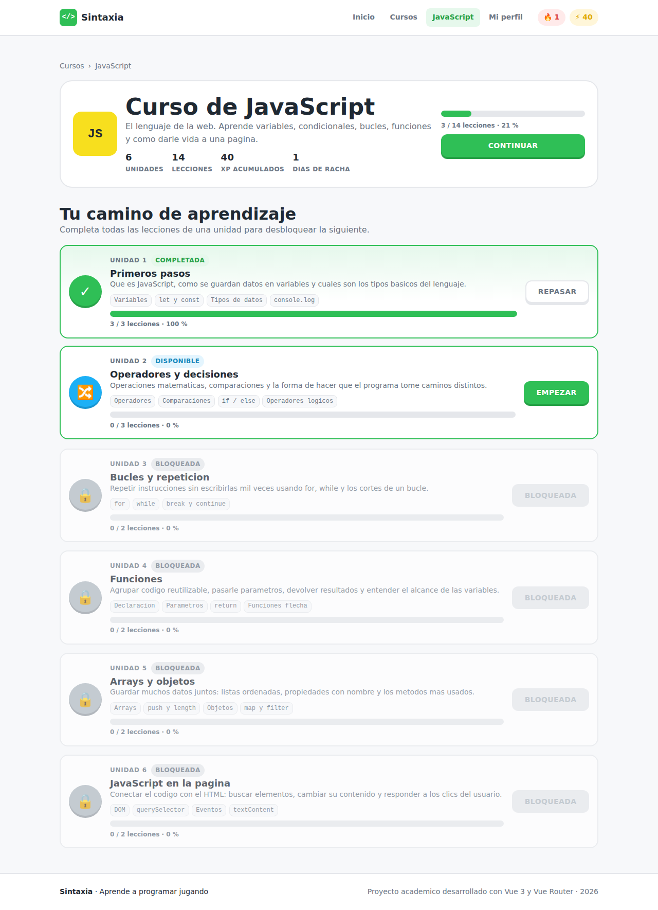

### Resolver un ejercicio
Pantalla completa, sin distracciones, con barra de progreso y vidas.

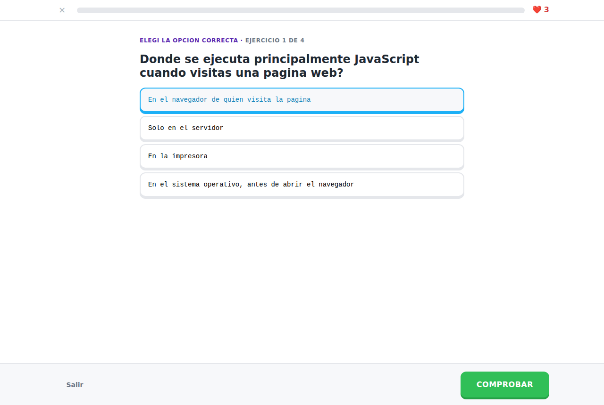

### Correccion inmediata
Al comprobar, la barra inferior dice si estuvo bien, cual era la respuesta y por que.

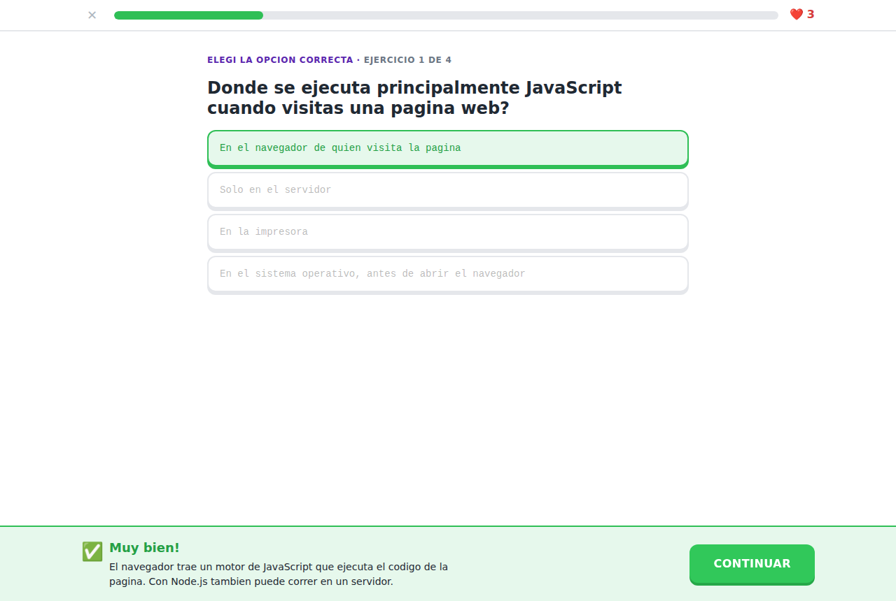

### Resultados

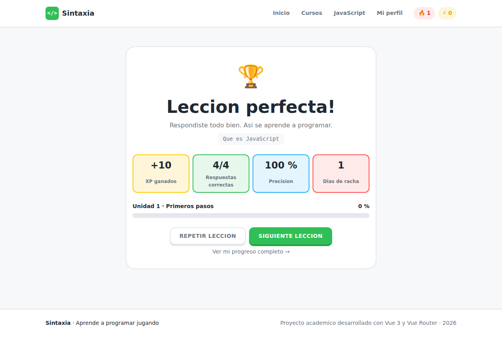

### Bienvenida
Lo primero que se ve al abrir la aplicacion: cuatro pasos que se pasan deslizando y terminan
ofreciendo entrar con una cuenta o seguir como invitado. En el escritorio se muestra
encuadrada con el ancho de un celular.

<p>
  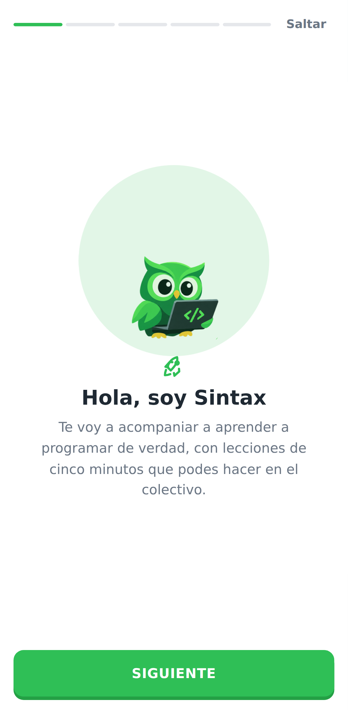
  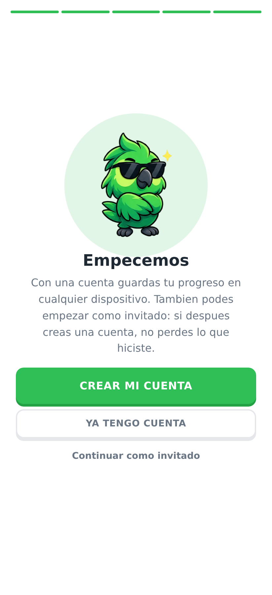
</p>

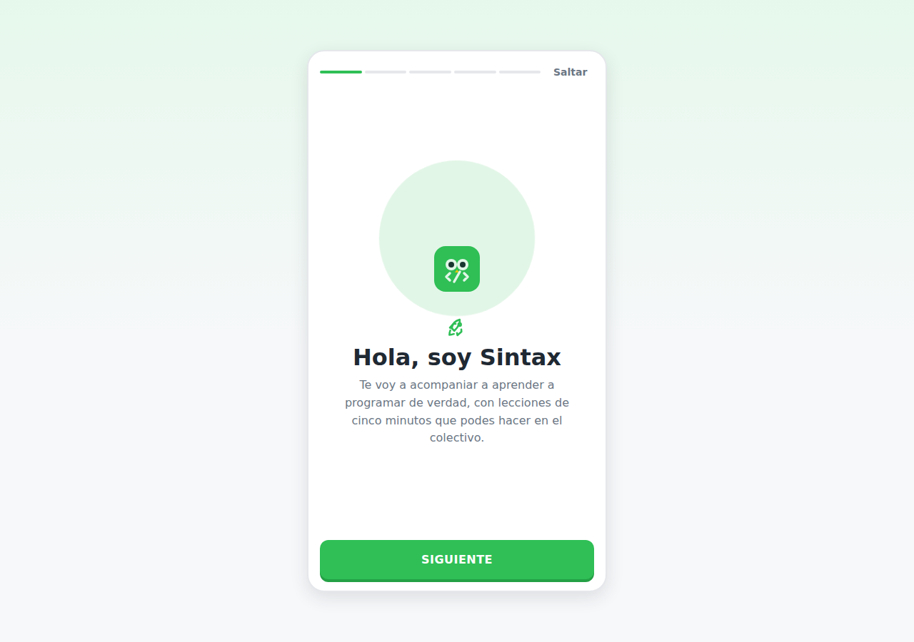

### Ingresar, crear cuenta o seguir como invitado
Correo y contrasena, o un usuario de invitado propio. Si ya hay un invitado, la pantalla
avisa que entrar a otra cuenta **no pasa su historial**.

<p>
  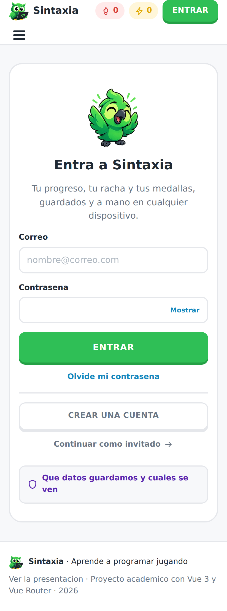
  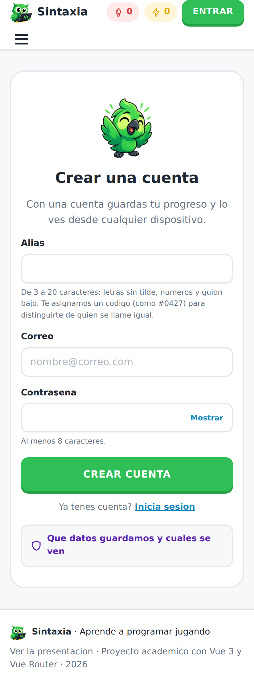
</p>

### Perfil
Alias con codigo (`Invitado#8681`, `Ana_Dev#1027`), si es invitado o cuenta, sus medallas,
su actividad y su progreso. Al invitado se le recuerda que su historial depende de la
sesion, y al cerrarla se le advierte antes.

<p>
  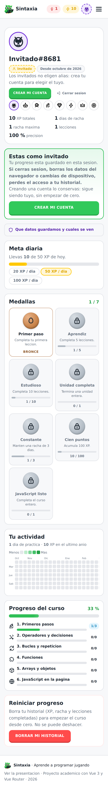
  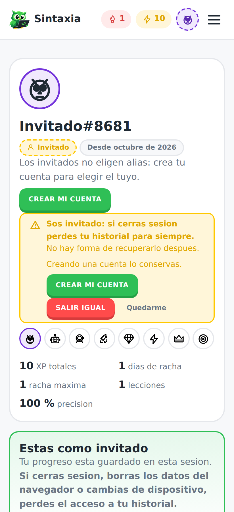
  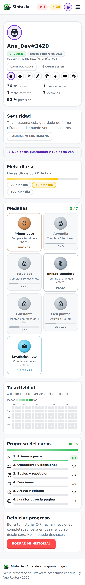
</p>

### Ranking
Todavia no esta disponible: necesita mostrar datos de otras personas y las politicas de
la base lo impiden hasta que exista una vista publica controlada. La pantalla lo explica.

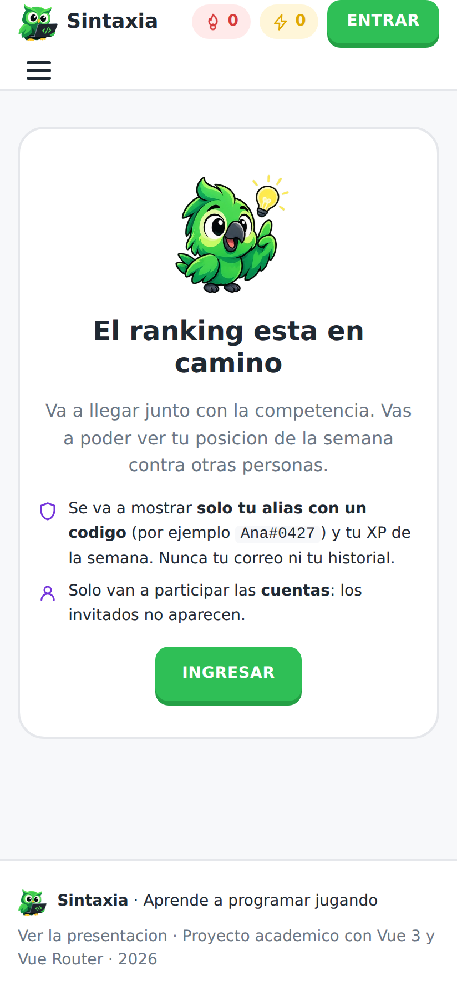

### En telefono

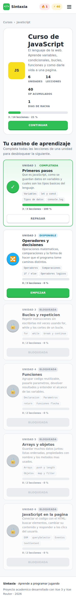

---

## Estructura del proyecto

```
supabase/
├── 00-roles-locales.sql      solo para reproducir el esquema fuera de Supabase
├── 01-esquema.sql            tablas, claves, restricciones y validaciones
├── 02-datos-iniciales.sql    carga inicial del contenido (generado)
├── 03-politicas-rls.sql      Row Level Security y permisos por columna
├── 04-funcion-comprobar.sql  correccion de respuestas del lado del servidor
├── 05-perfiles-y-progreso.sql   perfiles ligados a Auth (alias y codigo)
├── 06-politicas-rls-etapa4.sql  permisos y RLS: cada persona, solo lo propio
├── 07-limpieza-invitados.sql    borra invitados abandonados
├── 08-intentos-y-respuestas.sql intentos y respuestas (y migracion del historial anterior)
├── 09-funciones-intentos.sql    iniciar, responder y abandonar: el servidor corrige y calcula
├── 10-politicas-rls-etapa5.sql  cada persona lee solo su progreso; nadie lo escribe directo
└── README.md                 datos del proyecto y organizacion de las tablas

src/
├── servicios/         supabase.js (cliente) · auth.js · contenido.js · perfiles.js · progreso.js
├── constantes/        estados.js — vocabulario compartido con la base
├── assets/styles/     variables.css (identidad visual) + main.css
├── router/            rutas con nombre, el curso sale del identificador
├── data/              contenido de prueba: hoy solo alimenta al generador del
│                      script de carga inicial y a la API de cuentas
├── composables/       useAuth.js (sesion) · useProgreso.js · useCatalogo.js (cache)
├── utils/             estadisticas.js (mejor, ultimo, XP, racha) · respuestaPendiente.js
├── components/        BaseBoton, BarraProgreso, BarraFeedback, EstadoConsulta,
│                      CampoTexto, MensajeEstado, AvisoDatos, BotonCerrarSesion,
│                      MedallaCard, CalendarioActividad, CursoCard, UnidadCard,
│                      layout/ y ejercicios/
└── views/             una por ruta

server/                (etapa 2: YA NO LO USA LA APP; queda como referencia)
├── index.js           Express: middlewares, rutas y manejo de errores
├── config.js          Variables de entorno y validacion al arrancar
├── auth/              sesion.js (cookie JWT) · oauth.js (Google y GitHub)
├── db/                pool.js · migrar.js · sembrar.js · medallas.js · sql/
├── servicios/         usuarios · progreso · medallas · ranking
├── middleware/        autenticar.js
└── rutas/             auth · perfil · progreso · ranking
```

Detalle completo en [docs/02-estructura-y-arquitectura.md](docs/02-estructura-y-arquitectura.md).

---

## La unidad desarrollada

La **Unidad 1 - Primeros pasos** es la que esta desarrollada por completo para
esta etapa:

| Leccion | Teoria | Actividades |
|---|---|---|
| 1. Que es JavaScript | Explicacion + ejemplo con `console.log` | 4 de opcion multiple |
| 2. Variables y constantes | Explicacion + ejemplo con `let` y `const` | 4 de opcion multiple |
| 3. Tipos de datos | Explicacion + ejemplo con `typeof` | 4 de opcion multiple |

Cada leccion abre en su **pantalla de teoria**, con la explicacion y un ejemplo
de codigo que conserva el formato y se lee en el celular, y desde ahi se pasa a
las actividades. Las reglas de avance estan en
[docs/06](docs/06-reglas-de-avance.md).

Las otras cinco unidades tienen su teoria escrita y quedan **bloqueadas** hasta
completar la anterior.

## Contenido del curso de JavaScript

| Unidad | Titulo | Lecciones | Ejercicios |
|---|---|---|---|
| 1 | Primeros pasos | 3 | 11 |
| 2 | Operadores y decisiones | 3 | 9 |
| 3 | Bucles y repeticion | 2 | 6 |
| 4 | Funciones | 2 | 6 |
| 5 | Arrays y objetos | 2 | 6 |
| 6 | JavaScript en la pagina | 2 | 6 |
| | **Total** | **14** | **44** |

### Tipos de ejercicio

| Tipo | Como se responde |
|---|---|
| Opcion multiple | Se elige una entre varias opciones (se mezclan en cada intento) |
| Verdadero o falso | Dos botones grandes |
| Completar el codigo | Se escribe la palabra que falta dentro de un bloque de codigo |
| Ordenar bloques | Se tocan los bloques para armar el codigo en el orden correcto |

---

## Reglas del juego

- **3 vidas por leccion.** Si se pierden las tres antes de la ultima actividad, el intento
  se corta: la leccion no se completa ni suma XP.
- **Se aprueba con el 60 %** de aciertos, y aprobar habilita la leccion siguiente. Lo decide
  el servidor, que corrige y guarda cada respuesta.
- **Cada repeticion es un intento nuevo**: los anteriores quedan en el historial. Cuenta el
  mejor resultado, y repetir solo suma el XP que mejora.
- **Las unidades se desbloquean de a una**: hay que completar todas las lecciones de la
  anterior.
- **Racha diaria**: sube si se practico ayer, vuelve a 1 si se corto.
- **Meta diaria** configurable en el perfil (20, 50 o 100 XP).
- **14 medallas** en cuatro niveles (bronce, plata, oro y diamante). Las otorga el servidor,
  nunca el navegador.
- **Ranking semanal** por XP, que arranca de cero todos los lunes, y **ligas** segun el XP
  total acumulado.

## Cuentas y progreso

| | Sin sesion | Invitado | Cuenta |
|---|---|---|---|
| Ver el catalogo de cursos | si | si | si |
| Hacer lecciones y guardar progreso | no, pide ingresar | si | si |
| Alias | — | `Invitado#codigo` (no lo elige) | el que elija, con codigo |
| Donde se guarda el historial | — | Supabase, ligado a su sesion | Supabase, ligado a su cuenta |
| Se pierde al cerrar sesion o cambiar de dispositivo | — | **si** | no |
| Retomar una leccion a medias | — | en la misma sesion | en cualquier dispositivo |
| Aparecera en el ranking | no | no | si |

Un invitado que crea su cuenta **sigue siendo el mismo usuario**: conserva su historial, no
se crea otra cuenta ni se copia nada desde el cliente. Si en cambio entra a una cuenta que
ya existia, los historiales **no se fusionan** y la app lo advierte antes.

Cada persona ve y modifica solo sus datos (RLS). Detalle de los flujos, los permisos y la
configuracion de Supabase en [docs/12-acceso-y-sesiones.md](docs/12-acceso-y-sesiones.md).

Desde la etapa 5 cada respuesta se corrige y se guarda **en el servidor en el momento**: si
se cierra la app o se corta la conexion, lo respondido no se pierde y la leccion se retoma
donde quedo. La app muestra si cada respuesta esta guardada, pendiente o fallo, y nunca
dice "guardado" sin la confirmacion del servidor. Detalle en
[docs/14-intentos-y-progreso.md](docs/14-intentos-y-progreso.md).

---

## Nota sobre el repositorio

Este repositorio contenia un ejercicio de animacion CSS. Se conservo sin cambios en
[`legacy/animacion/`](legacy/animacion/) y el proyecto Vue se monto alrededor. El violeta de
la identidad visual (`#7434db`) es justamente el color de aquel ejercicio.
