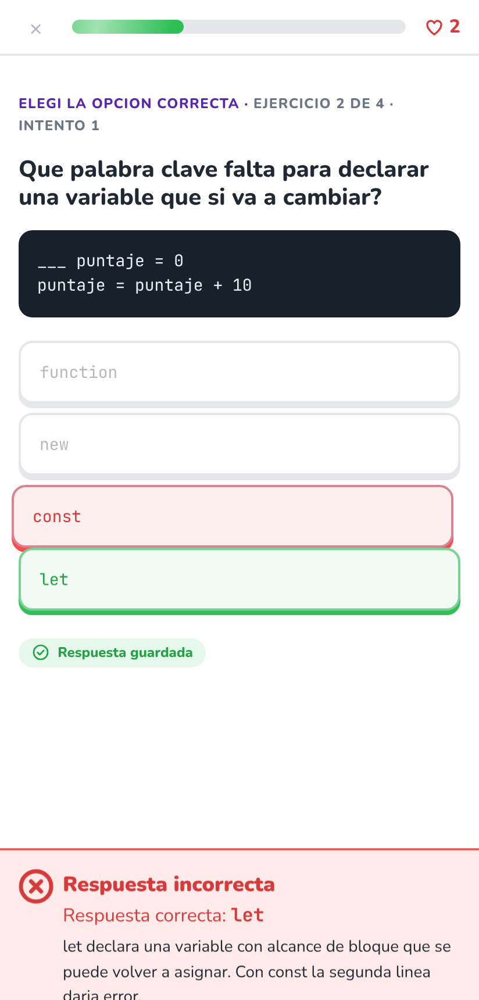
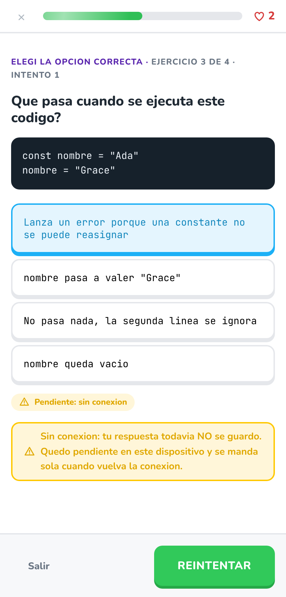
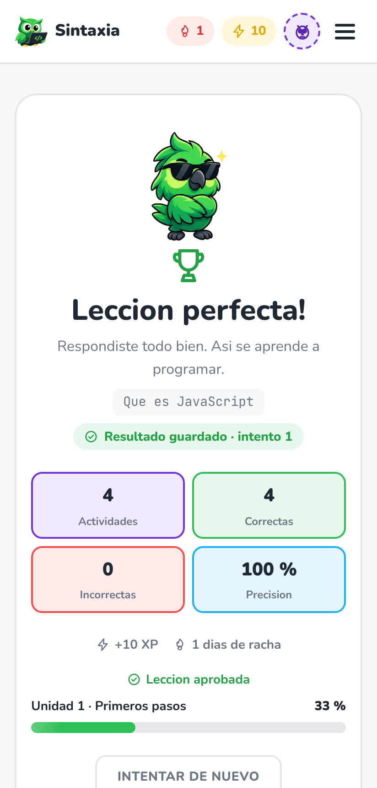
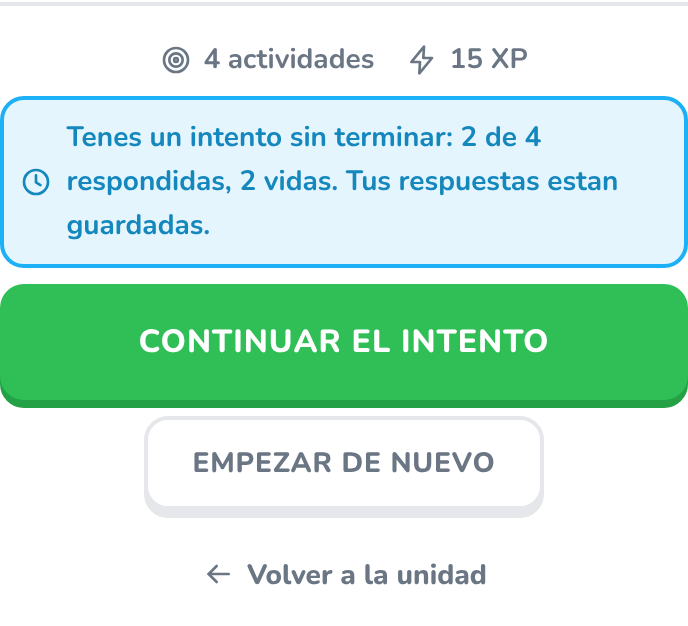
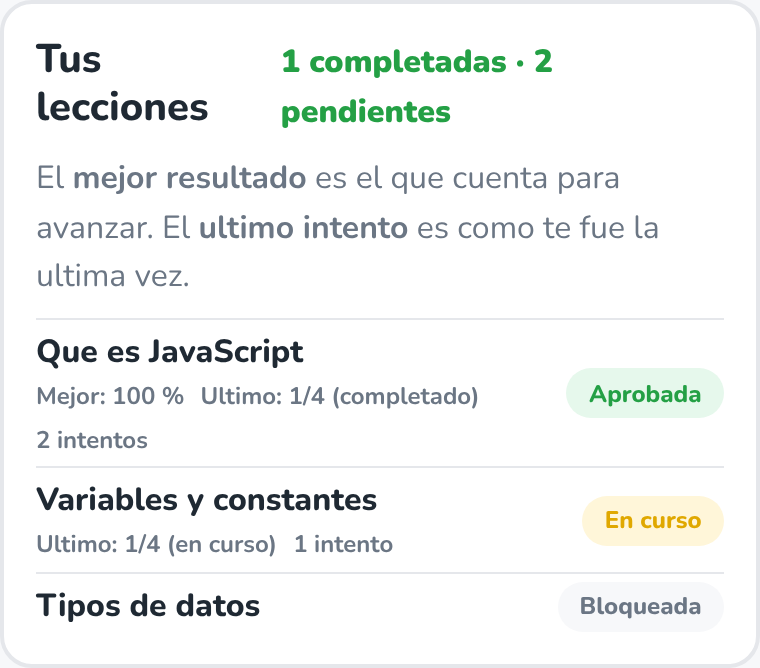
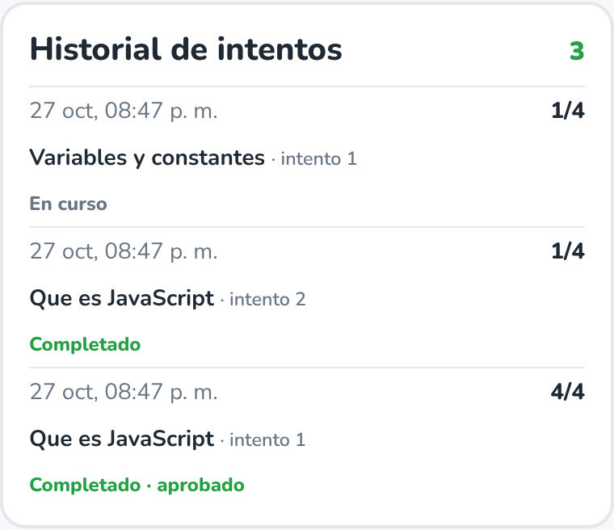

# 14. Intentos, respuestas y progreso (etapa 5)

Este documento explica como guarda Sintaxia el progreso de cada participante
desde la etapa 5: que se conserva de cada intento, quien calcula el resultado,
como se evitan los duplicados, que pasa si se corta la conexion y que muestra el
perfil.

Scripts: [`supabase/08-intentos-y-respuestas.sql`](../supabase/08-intentos-y-respuestas.sql),
[`09-funciones-intentos.sql`](../supabase/09-funciones-intentos.sql) y
[`10-politicas-rls-etapa5.sql`](../supabase/10-politicas-rls-etapa5.sql).
Diagrama: [`der/sintaxia-der-etapa5.png`](der/sintaxia-der-etapa5.png)
([`.drawio`](der/sintaxia-der-etapa5.drawio)).

---

## 14.1 Que cambio respecto de la etapa 4

| | Etapa 4 | Etapa 5 |
|---|---|---|
| Tabla | `intentos_leccion` (un renglon al **terminar**) | `intentos` (uno al **empezar**) + `respuestas` (una por actividad) |
| Quien dice cuantas acerto | **El celular** mandaba `aciertos` y `total` | **El servidor** las cuenta a partir de las respuestas guardadas |
| Correccion | `comprobar_respuesta` corregia pero no guardaba | `responder_actividad` corrige **y** guarda |
| Escritura desde el cliente | `insert` permitido en la tabla | Ningun `insert` ni `update`: solo funciones del servidor |
| Cerrar a mitad de una leccion | Se perdia lo respondido | Se retoma donde quedo, en ese o en otro dispositivo |
| Repetir una leccion | Otro renglon, sin detalle | Otro **intento** (numero 2, 3...) con todas sus respuestas |

El historial que ya existia no se pierde: el script 08 copia cada renglon de
`intentos_leccion` como un intento completado con `origen = 'etapa4'`, y recien
despues borra la tabla vieja (ver 14.9).

---

## 14.2 El modelo

```
perfiles (etapa 4) ──1:N──► intentos ──1:N──► respuestas ◄──N:1── preguntas (contenido)
                               ▲                    │
lecciones (contenido) ──1:N────┘                    └──N:1──► opciones (contenido)
```

**`intentos`** – un renglon cada vez que un participante empieza una leccion.

| Columna | Que guarda |
|---|---|
| `id` (uuid, PK) | Lo genera **el celular** antes de pedir el intento (ver 14.5). |
| `usuario_id` (FK perfiles) | La persona. La pone el servidor con `auth.uid()`, nunca el cliente. |
| `leccion_id` (FK lecciones) | La leccion. |
| `numero` | 1, 2, 3... por persona y leccion. **Unico** `(usuario_id, leccion_id, numero)`. |
| `estado` | `en_curso`, `completado`, `sin_vidas` o `abandonado` (14.3). |
| `origen` | `servidor` o `etapa4` (copiado del historial anterior). |
| `total_actividades` | Foto de cuantas actividades publicadas tenia la leccion al empezar. |
| `aciertos`, `errores` | Los calcula el servidor contando `respuestas`. |
| `porcentaje` | Columna generada: `aciertos * 100 / total_actividades`. |
| `aprobado` | Lo decide el servidor al cerrar el intento (60 % o mas). |
| `iniciado_en`, `actualizado_en`, `finalizado_en` | Fechas. `finalizado_en` vacio mientras esta en curso. |

**`respuestas`** – una por actividad respondida dentro de un intento.

| Columna | Que guarda |
|---|---|
| `intento_id` + `pregunta_id` (**PK**) | Una sola respuesta por actividad **e intento**. |
| `opcion_id` | La opcion elegida. Clave foranea compuesta `(opcion_id, pregunta_id)` → `opciones(id, pregunta_id)`: la opcion tiene que ser de esa actividad. |
| `es_correcta` | Foto de la correccion en el momento de responder. |
| `orden` | En que orden se respondio (1, 2, 3...). Unico por intento. |
| `respondida_en` | Cuando. |

### Restricciones que sostienen las reglas

| Restriccion | Para que |
|---|---|
| `pk_respuestas (intento_id, pregunta_id)` | Una respuesta por actividad e intento, aunque la peticion llegue dos veces. |
| `uq_intentos_numero (usuario_id, leccion_id, numero)` | Repetir una leccion crea el intento siguiente, no pisa el anterior. |
| `uq_intentos_en_curso` (indice unico parcial `where estado = 'en_curso'`) | Un solo intento abierto por persona y leccion: es el que se retoma. |
| `ck_intentos_completo` | `completado` solo si respondio todas: `aciertos + errores = total_actividades`. |
| `ck_intentos_aprobado` | Solo un intento completado puede estar aprobado. |
| `ck_intentos_cierre` | En curso ⇔ sin `finalizado_en`. |
| `ck_intentos_conteo` | Aciertos y errores no negativos y nunca mas que el total. |
| `fk_respuestas_opcion (opcion_id, pregunta_id)` | No se puede guardar una opcion de otra actividad. |

### Progreso separado de la publicacion

- El contenido (`cursos` ... `opciones`) **no tiene ninguna columna del
  participante**, y `intentos`/`respuestas` **no tienen ninguna columna de
  publicacion**. Publicar, despublicar o corregir contenido no escribe en el
  progreso, y responder no escribe en el contenido.
- Cada intento guarda **fotos** (`total_actividades`, `es_correcta`): si despues
  se corrige que opcion era la correcta, el historial queda como se corrigio en
  su momento (probado: caso 10 de la etapa 5).
- Contenido que ya tiene intentos **no se puede borrar** (`on delete restrict`):
  se despublica con `estado = 'borrador'`. Asi nadie pierde su historial porque
  alguien edito el curso. Los intentos de una leccion despublicada se siguen
  viendo en el perfil.

---

## 14.3 Estados de un intento y reglas aplicadas

Las reglas son las acordadas en la etapa 2 ([06-reglas-de-avance.md](06-reglas-de-avance.md)),
ahora aplicadas **en el servidor** (`09-funciones-intentos.sql`):

```
                 responde la ultima actividad
   en_curso ─────────────────────────────────────► completado  (aprobado si >= 60 %)
      │
      ├── 3er error ANTES de la ultima ─────────────► sin_vidas   (no completa, no aprueba)
      │
      └── empieza otro intento de la misma leccion ─► abandonado  (queda en el historial)
```

| Regla (etapa 2) | Donde se aplica |
|---|---|
| Completada = respondio todas las actividades | `responder_actividad` |
| Aprobada = completada con 60 % o mas | `responder_actividad` (constante `umbral_aprobacion()`) |
| 3 vidas; el tercer error antes de la ultima corta el intento | `responder_actividad` (`vidas_por_intento()`) |
| Una leccion se abre si es la primera de su unidad, la anterior esta aprobada o ya la habia completado | `leccion_disponible_para()`, que `iniciar_intento` consulta antes de crear el intento |
| Una unidad se abre si es la primera, la anterior esta completa (todas sus lecciones aprobadas) o ya esta completa | `unidad_completada_por()` |
| Se conserva el mejor resultado | Ningun intento se borra; la leccion esta aprobada si **algun** intento completado quedo aprobado |

La app tiene las mismas reglas en `useProgreso.js` para pintar la pantalla al
instante, pero **la que decide es la del servidor**: aunque alguien arme la
peticion a mano, no puede empezar una leccion bloqueada (caso 7) ni abrirla
desde la direccion (caso 19).

Cambio respecto de la etapa 2: "reintentar arranca de cero" sigue siendo cierto
para el intento nuevo (actividad 1, tres vidas), pero **el intento anterior ya no
se descarta**: queda guardado con sus respuestas.

---

## 14.4 Las funciones del servidor

El cliente no tiene permiso de `insert` ni `update` sobre `intentos` ni
`respuestas`. Todo pasa por tres funciones `SECURITY DEFINER`, ejecutables solo
con sesion (invitado o cuenta):

| Funcion | Recibe | Hace |
|---|---|---|
| `iniciar_intento(p_intento_id uuid, p_leccion_id text)` | Un id nuevo y la leccion | Verifica sesion, desbloqueo y tope de invitado; cuenta las actividades publicadas; marca `abandonado` el intento en curso anterior; crea el intento con el numero siguiente. Si el id ya existe y es de la misma persona, lo devuelve sin crear otro. |
| `responder_actividad(p_intento_id uuid, p_pregunta_id text, p_opcion_id text)` | Solo identificadores | Bloquea el renglon del intento; si esa actividad ya estaba respondida devuelve la respuesta guardada (`repetida: true`); si no, comprueba que el intento sea propio y este en curso, que la actividad sea de esa leccion y la opcion de esa actividad; guarda la respuesta; **recuenta** aciertos y errores desde `respuestas`; cierra el intento si corresponde. Devuelve la correccion (igual que `comprobar_respuesta`) y el intento recalculado. |
| `abandonar_intento(p_intento_id uuid)` | El intento | Lo cierra como `abandonado` si estaba en curso. Repetirlo no cambia nada. |

**No hay ningun parametro por donde mandar un porcentaje o una cantidad de
aciertos.** Si se agrega uno (`p_aciertos`, `p_porcentaje`) la llamada falla
porque esa funcion no existe (caso 2).

Los errores llegan con un `HINT` fijo que la app traduce a un mensaje:
`sin_sesion`, `leccion_bloqueada`, `tope_invitado`, `sin_actividades`,
`intento_no_encontrado`, `intento_cerrado`, `intento_de_otra_leccion`,
`actividad_no_encontrada`, `opcion_no_encontrada`. Un intento ajeno responde
igual que uno inexistente (`intento_no_encontrado`): no se revela que existe.

`comprobar_respuesta` (etapa 3) sigue existiendo para el modo practica sin
sesion; la pantalla de actividades ya no la usa.

---

## 14.5 Peticiones repetidas: identificadores y restricciones

Con conexiones moviles es normal que una peticion llegue al servidor pero la
respuesta no vuelva. El cliente reintenta, y el servidor no tiene que contar dos
veces.

| Peticion | Como se evita el duplicado |
|---|---|
| Empezar un intento | El **id lo genera el celular** (`crypto.randomUUID()`) antes de pedirlo, y se reutiliza en cada reintento. Si el servidor ya lo creo, `iniciar_intento` lo devuelve (`repetida: true`). Ademas las peticiones de una misma persona se atienden de a una (`pg_advisory_xact_lock`), y el indice `uq_intentos_en_curso` impide dos intentos abiertos. |
| Responder una actividad | La clave `(intento_id, pregunta_id)` admite **una sola fila**. `responder_actividad` bloquea el intento (`for update`), y si la actividad ya tiene respuesta devuelve la guardada. Si en el reintento llega **otra** opcion, vale la primera: la app muestra la que quedo guardada. |
| Abandonar | Solo cambia un intento en curso; repetirlo no hace nada. |

Probado con la misma peticion repetida y con cinco peticiones iguales al mismo
tiempo (casos 3 y 4), y desde la app perdiendo la respuesta del servidor a
proposito (casos 15 y 21).

---

## 14.6 Salir, cerrar la app o perder la conexion

Cada respuesta se guarda **en el momento en que se comprueba**, no al final. Por
eso no hay un "guardar resultado" que se pueda perder.

| Situacion | Que pasa |
|---|---|
| **Salir** de la leccion (boton Salir o la X) | El intento queda `en_curso` con lo respondido. La pantalla de la leccion avisa "Tenes un intento sin terminar: 2 de 4 respondidas, 2 vidas" y ofrece **Continuar el intento** o **Empezar de nuevo** (el anterior queda `abandonado`). |
| **Cerrar la app** o la pestana | Igual que salir: al volver se retoma en la primera actividad sin responder, con las vidas que tenia. Con cuenta, tambien desde **otro dispositivo**. |
| **Sin conexion al comprobar** | La respuesta **no se corrige ni se cuenta**: queda "Pendiente: sin conexion" con el aviso "tu respuesta todavia NO se guardo". Se anota en el dispositivo y se reenvia sola cuando vuelve la conexion (evento `online`), o con **Reintentar**, o al volver a abrir la leccion. |
| **Llego la peticion pero no la respuesta** | La app la muestra pendiente; al reintentar el servidor devuelve la respuesta guardada sin sumarla de nuevo. |
| **El servidor la rechaza** (intento cerrado, actividad despublicada) | Estado "No se guardo", con el motivo. |

### Lo que la app muestra (y lo que no afirma)

Cada respuesta tiene un estado visible arriba de la actividad:

| Estado | Texto | Cuando |
|---|---|---|
| `enviando` | Guardando... | Se esta mandando |
| `guardado` | Respuesta guardada | **Solo** cuando el servidor contesto |
| `pendiente` | Pendiente: sin conexion | No hubo respuesta; se reenvia sola |
| `fallo` | No se guardo | El servidor la rechazo |

La pantalla de **resultados** recibe solo el id del intento
(`/lecciones/:id/resultados?intento=...`) y le pide los numeros al servidor. Si
no puede consultarlo dice **"No pudimos confirmar tu resultado"** y no muestra
ningun puntaje; recien con la respuesta del servidor dice **"Resultado guardado ·
intento N"**. Los numeros nunca salen de la direccion: aunque alguien escriba
`&aciertos=4` en la URL, se muestra lo que guardo el servidor (caso 16).

| Respuesta confirmada | Sin conexion | Resultado confirmado |
|---|---|---|
|  |  |  |

Al volver a una leccion que quedo a medias:



---

## 14.7 Guardar y recuperar por identidad

- Cada intento es del `auth.uid()` de la sesion. El cliente no elige de quien es.
- Las lecturas son `select` comunes (`intentos`, `respuestas`) filtrados por RLS:
  cada persona ve solo lo suyo. El historial se carga al iniciar sesion y se
  descarta al cerrarla; no hay copia del progreso en el navegador.
- Con una **cuenta**, el mismo historial aparece en cualquier dispositivo, incluso
  un intento a medias (caso 13).
- Un **invitado** conserva su progreso mientras conserve la sesion. Si crea su
  cuenta, el id no cambia y sus intentos siguen siendo suyos (etapa 4).
- La unica copia local es la **respuesta pendiente** de 14.6
  (`sintaxia:respuesta-pendiente`), atada al usuario y al intento. Si el
  navegador no deja guardar, la app sigue andando y la opcion se elige de nuevo.

### Permisos (RLS)

| | Publico (`anon`) | Invitado / cuenta |
|---|---|---|
| `intentos` | nada | **ver** y **borrar** los propios |
| `respuestas` | nada | **ver** las de sus intentos |
| `insert` / `update` en esas tablas | no | **no** (solo las funciones) |
| `iniciar_intento`, `responder_actividad`, `abandonar_intento` | no (401) | si, sobre lo propio |

Un participante no puede responder, abandonar, leer, modificar ni borrar
intentos de otro, ni reutilizar el id de un intento ajeno (caso 9). Borrar el
propio historial ("Reiniciar progreso" en el perfil) se lleva sus respuestas en
cascada.

---

## 14.8 El perfil: lecciones, ultimo intento e historial

El perfil separa tres cosas:

1. **Tus lecciones** – una fila por leccion con su situacion:
   *Aprobada*, *Completada sin aprobar*, *En curso*, *Pendiente* (habilitada y
   sin completar) o *Bloqueada*. Encabezado: "N completadas · M pendientes".
   En cada fila, por separado:
   - **Mejor**: el mejor porcentaje entre los intentos completados (el que cuenta
     para avanzar);
   - **Ultimo**: como termino la ultima vez (por ejemplo `1/4 (completado)` o
     `0/4 (sin vidas)`), aunque sea peor que el mejor;
   - cantidad de intentos.
2. **Historial de intentos** – todos los intentos, del mas nuevo al mas viejo:
   fecha, leccion, numero de intento, aciertos/total, estado y si aprobo. Los
   copiados de la etapa 4 llevan la marca "anterior".
3. Los totales de siempre (XP, racha, calendario), calculados **solo con
   intentos completados**: uno en curso, sin vidas o abandonado queda en el
   historial pero no suma XP.

| Tus lecciones | Historial de intentos |
|---|---|
|  |  |

La pantalla de la leccion tambien distingue el **mejor resultado** del **ultimo
intento**.

---

## 14.9 Migracion desde la etapa 4

En un proyecto que ya tenia la etapa 4 alcanza con ejecutar `08`, `09` y `10`
(en ese orden). El `08`:

1. crea `intentos` y `respuestas` (si no existen);
2. si existe `intentos_leccion`, copia cada renglon como intento `completado`
   con `origen = 'etapa4'`, misma fecha, `aprobado` segun el 60 %, numerado
   despues de los intentos que ya hubiera;
3. borra `intentos_leccion` y la funcion auxiliar `cantidad_intentos_propios()`.

Esos intentos no tienen respuestas (la etapa 4 no las guardaba) y sus aciertos
los habia informado el cliente: quedan marcados, pero **se siguen contando** para
no quitarle a nadie lo que ya habia desbloqueado (caso 11).

Los scripts `05` y `06` ya no crean ni mencionan `intentos_leccion`, y `07`
(limpieza de invitados) mira la actividad en `intentos`. Los scripts `02` y `05`
a `10` se pueden volver a correr sin perder datos ni permisos (caso 34 de la
etapa 4 y caso 20 de la etapa 5).

---

## 14.10 Donde esta implementado

| Que | Archivo |
|---|---|
| Tablas, restricciones, migracion | `supabase/08-intentos-y-respuestas.sql` |
| Reglas, correccion y calculo | `supabase/09-funciones-intentos.sql` |
| Permisos y RLS | `supabase/10-politicas-rls-etapa5.sql` |
| Acceso a los datos desde la app | `src/servicios/progreso.js` |
| Retomar, responder, estados de guardado | `src/views/LeccionView.vue`, `src/utils/respuestaPendiente.js` |
| Resultado confirmado por el servidor | `src/views/ResultadosView.vue` |
| Continuar / empezar de nuevo, ultimo intento | `src/views/LeccionIntroView.vue` |
| Lecciones e historial del perfil | `src/views/PerfilView.vue` |
| Mejor, ultimo, XP y racha a partir del historial | `src/utils/estadisticas.js`, `src/composables/useProgreso.js` |
| Pruebas | `pruebas/etapa5.mjs` ([registro](15-registro-de-pruebas-etapa5.md)) |

## 14.11 Limites conocidos

- El **ranking** sigue sin activarse: el XP se calcula en la app a partir de los
  intentos (todos validados por el servidor), pero todavia no hay una tabla de
  puntajes publicos.
- La app sigue siendo web. La reescritura con Quasar (para el celular) viene
  despues; el modelo de datos y las funciones del servidor no dependen de eso.
- Si se cambia el umbral de aprobacion, los intentos ya cerrados conservan el
  `aprobado` con el que se guardaron (es una foto, como las respuestas).
